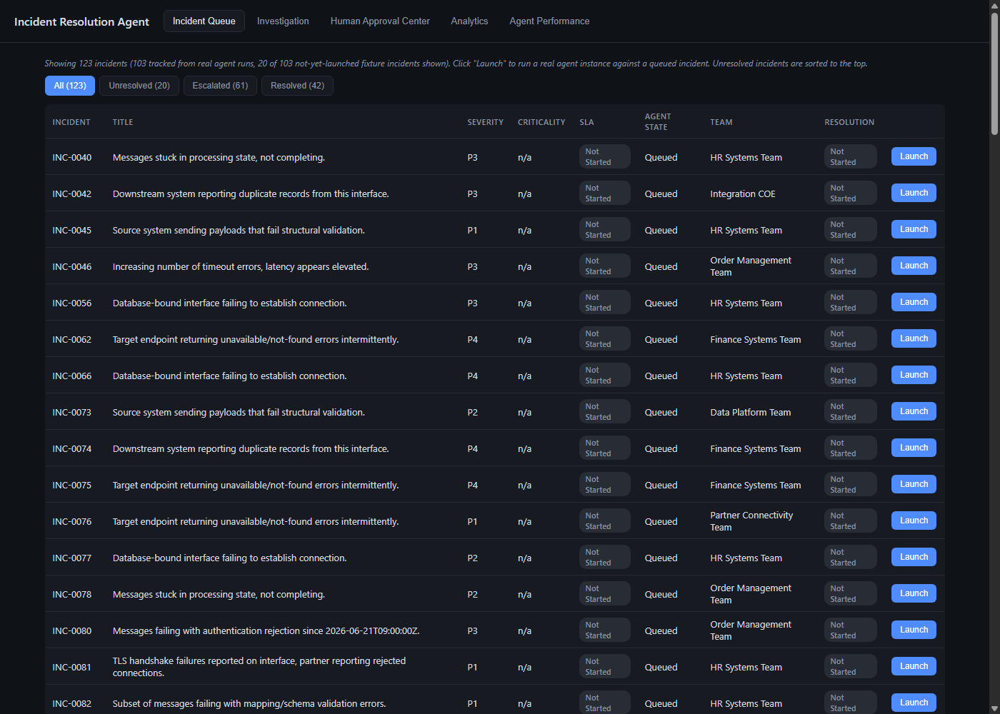
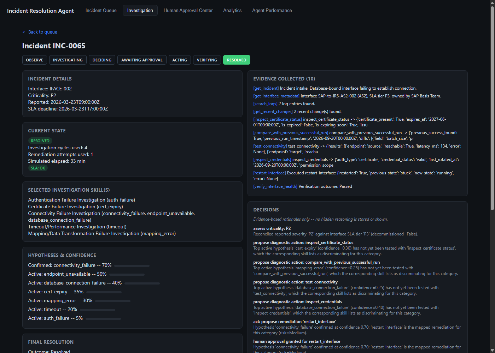
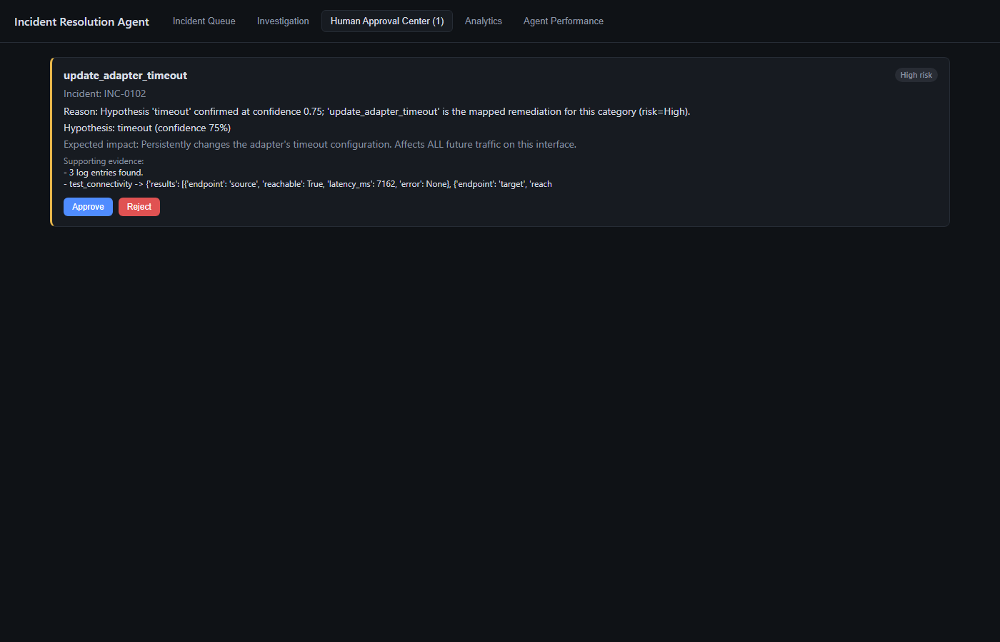
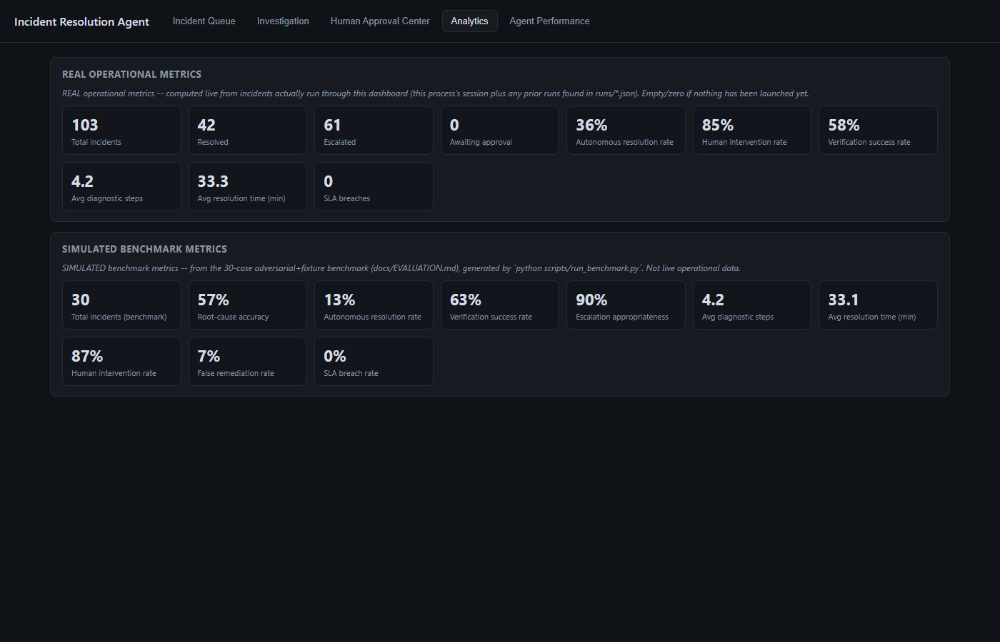
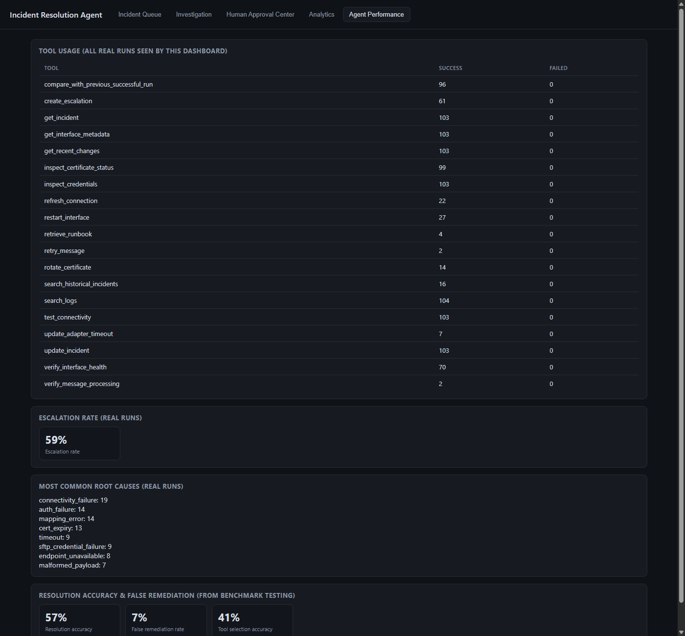

# Enterprise Integration Incident Resolution Agent

Docs: [PROJECT_SPEC.md](docs/PROJECT_SPEC.md) · [AGENT_ARCHITECTURE.md](docs/AGENT_ARCHITECTURE.md) · [TOOL_SPEC.md](docs/TOOL_SPEC.md) · [MCP_ARCHITECTURE.md](docs/MCP_ARCHITECTURE.md) · [RISK_POLICY.md](docs/RISK_POLICY.md) · [EVALUATION.md](docs/EVALUATION.md) · [DASHBOARD.md](docs/DASHBOARD.md) · [skills/](docs/skills/README.md)

## Dashboard walkthrough

The dashboard (`python -m dashboard.server`, then `http://127.0.0.1:5050/`) is an operational console for launching real agent runs, approving/rejecting gated actions live, and reviewing analytics — it never reimplements agent logic, only reads and drives it. It requires a running Python process, so it can't be viewed as a static GitHub page; the screenshots below show it in action, and there's a full **[video walkthrough](docs/media/dashboard_demo.mp4)** (click through to GitHub's file view, which plays it inline).

**Incident Queue** — every real agent run this dashboard has seen, plus not-yet-launched fixture incidents, with filter tabs (unresolved sorted to the top):



**Incident Investigation** — full chronological trace for a selected incident: hypotheses with confidence bars, evidence, evidence-based decisions (no hidden reasoning), verification results, final resolution:



**Human Approval Center** — a real pending approval from a live, currently-blocked agent thread; Approve/Reject here genuinely unblocks or redirects that thread:



**Analytics** — real operational metrics (computed live from actual runs) kept explicitly separate from simulated benchmark metrics (from `docs/EVALUATION.md`'s 30-case benchmark):



**Agent Performance** — tool usage, escalation rate, and root-cause distribution across every real run, plus benchmark-derived accuracy figures:



## Run

```bash
python main.py INC-0099
python main.py INC-0005 --quiet
python main.py --sample 20 --quiet

# Run against the MCP server instead of importing the tool layer directly
python main.py INC-0099 --mcp

# Adversarial evaluation suite (10 scenarios designed so the obvious first hypothesis is wrong)
python scripts/run_eval.py

# 30-case benchmark across 12 metrics -- writes reports/EVALUATION_REPORT.md
python scripts/build_benchmark.py
python scripts/run_benchmark.py

# Print the full observability timeline (incident, state, skill, tools, hypotheses,
# confidence changes, decisions, actions, verification, escalation, resolution)
python main.py INC-0099 --quiet --observe

# End-to-end test suite (10 scenarios, >=3 adversarial) -- pytest, or the report generator
pytest tests/test_e2e_agent.py -v
python scripts/run_e2e_tests.py   # writes reports/E2E_TEST_REPORT.md

# Operational dashboard -- launch real incidents, approve/reject live, view analytics
python -m dashboard.server        # then open http://127.0.0.1:5050/
```

Every run also writes `runs/<incident_id>.timeline.txt` automatically (alongside the raw `runs/<incident_id>.json` trace), whether or not `--observe` is passed.

Each run writes a full trace (state, evidence, hypotheses with confidence history, every tool call, every decision) to `runs/<incident_id>.json`. Resolved/escalated outcomes are also appended to `data/learned_resolutions.json` (case memory) and picked up by `search_historical_incidents` on subsequent runs.

Regenerate the fixture dataset (50 interfaces, 100 incidents, 200 logs, 20 runbooks, 30 configs, 20 resolution records) with:

```bash
python scripts/generate_fixtures.py
```

## Package layout

- `agent/models.py` — state model (`IncidentState`, `Evidence`, `Hypothesis`, `DiagnosticAction`, `RemediationAction`, `VerificationResult`, `Escalation`, `ResolutionRecord`).
- `agent/registry.py` — static tool registry (risk tier, approval requirement, autonomy) — never derived from agent output.
- `agent/simulated_tools.py` — simulated implementations of all 18 tools from `docs/TOOL_SPEC.md`, keyed off each fixture incident's hidden ground-truth category/outcome bucket.
- `agent/skills.py` — machine-readable form of the skill docs (tool priority per category, evidence interpretation hints).
- `agent/reasoning.py` — the "brain": proposes one next action per turn from current state; never calls a tool directly.
- `agent/guardrails.py` — deterministic ceilings (investigation cycles, remediation attempts, verification retries, SLA-forced decide) and approval gating.
- `agent/orchestrator.py` — the OBSERVE→…→RESOLVED/ESCALATED state machine; dispatches proposals through guardrails, applies the uniform post-tool-call state update, and writes the run trace. Talks to tools via whatever `env` it's given (`SimulatedEnvironment`, `ScenarioEnvironment`, or `MCPToolClient`) — it never imports a tool implementation itself.
- `agent/mcp_tool_client.py` — synchronous MCP client facade used as `env` when running with `--mcp`; proxies every tool call over MCP to `mcp_server/server.py` with no per-tool boilerplate.
- `mcp_server/server.py` — standalone MCP server ("Enterprise Integration Operations platform") exposing all 18 tools, backed by the same `agent/simulated_tools.py` logic. See `docs/MCP_ARCHITECTURE.md` for the client/server split and how a real ServiceNow/SAP/observability backend would replace it.
- `data/eval_scenarios.json` + `agent/eval_environment.py` + `scripts/run_eval.py` — 10 hand-authored adversarial scenarios (misleading errors, multiple plausible causes, shared-infra failures, stale precedents, contradictory evidence, keyword traps, etc.) and the harness that scores the agent against them.
- `agent/memory.py` — the two memory layers. Investigation memory is `IncidentState` itself (aliased here, not duplicated). `ResolutionMemory` is the sole gateway to long-term case memory: reads are unrestricted (used for hypothesis corroboration), but `promote()` is the only write path and structurally refuses anything not backed by a `Passed` `VerificationResult` — escalations go to `data/escalation_archive.json` instead, which is never consulted by `search_historical_incidents`. See `docs/RISK_POLICY.md`-adjacent enforcement in `agent/guardrails.py::check_hypothesis_has_direct_evidence`, which additionally refuses to act on a hypothesis supported only by historical precedent with no direct evidence from the current incident.
- `agent/risk_policy.py` + `config/risk_policy.json` — the risk-based autonomy framework (LOW/MEDIUM/HIGH). See `docs/RISK_POLICY.md`.
- `data/benchmark_incidents.json` + `scripts/build_benchmark.py` + `scripts/run_benchmark.py` — 30-case evaluation benchmark (10 adversarial + 20 bulk-fixture, covering all 11 root-cause categories) and the harness that computes the 12 metrics in `docs/EVALUATION.md`, writing `reports/EVALUATION_REPORT.md`.
- `agent/observability.py` — renders an `IncidentState` into a concise, human-readable timeline (incident, current state, skills engaged, tools called + results, hypotheses, confidence changes, decisions, actions, verification, escalation, final resolution). Shows only evidence-cited rationale (the same `DecisionLogEntry`/`confidence_history` structures used everywhere else in the codebase) — there is no separate hidden chain-of-thought to redact, since `agent/reasoning.py` never produces one.
- `data/e2e_scenarios.json` + `tests/e2e_lib.py` + `tests/test_e2e_agent.py` + `scripts/run_e2e_tests.py` — the pre-dashboard end-to-end validation suite: 10 scenarios (auth failure, expired cert, SFTP connectivity, REST endpoint failure, mapping error, timeout, database connectivity, shared-dependency multi-interface failure, a genuinely ambiguous incident, and an escalate-only case), 3 of them adversarial. Checks 14 capabilities per scenario plus cross-scenario proof the agent isn't following a fixed workflow (7 distinct tool-call sequences across 10 scenarios) and a structural no-approval-bypass check. `pytest tests/test_e2e_agent.py -v` for CI-style pass/fail; `python scripts/run_e2e_tests.py` for the full narrative report (`reports/E2E_TEST_REPORT.md`).
- `dashboard/` — the operational dashboard (Flask + vanilla JS, no build step). `registry.py` launches real `Orchestrator` instances in background threads and bridges Human Approval Center decisions to the real, blocking `approval_callback`; `data_sources.py`/`serializer.py` only read existing agent state and generated reports, never reimplement agent logic. Supports deep links (`?incident=INC-0001#investigation`). See `docs/DASHBOARD.md` and the screenshots above.

## Note on the agent's "reasoning"

This MVP implements the agent's brain as an evidence-driven heuristic scorer (`agent/reasoning.py`), not an LLM call — tool selection is genuinely dynamic (varies per incident based on which hypotheses are active and untested) but the scoring itself is deterministic Python, not a model. Swapping in an LLM-backed reasoning component later means replacing `propose_next_diagnostic`/`decide_act_or_escalate` internals while keeping their input (full `IncidentState`) and output (one proposed action) contracts unchanged — the same durability principle used for the tool layer in `docs/TOOL_SPEC.md` §8.
